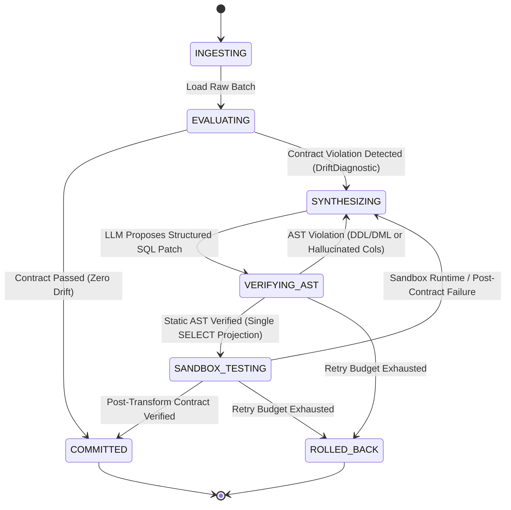

# Self-Healing Data Pipeline & Autonomous Schema Drift Agent


An autonomous, deterministic **Finite State Machine (FSM)** orchestration engine that intercepts, diagnoses, and repairs upstream schema drift and statistical data contract violations in analytical ingestion pipelines without human intervention.

Unlike fragile prompt-wrappers that grant LLMs direct execution access to production databases, this system enforces **zero-trust execution** via two compiler-grade barriers: **Static AST Verification** (`SQLGlot`) and **Transactional Copy-on-Write Sandboxing** (`DuckDB`).

---

## Key Architectural Highlights

* **Dual-Layer Data Contracts (`src/contracts.py`):** Evaluates incoming data batches against both structural invariants (column presence, data types) and statistical distribution bounds (null-rate thresholds, min/max quantile shifts).
* **Deterministic FSM Controller (`src/orchestrator.py`):** Governs execution through strict state transitions (`INGESTING` -> `EVALUATING` -> `SYNTHESIZING` -> `VERIFYING_AST` -> `SANDBOX_TESTING` -> `COMMITTED` / `ROLLED_BACK`) backed by an append-only **SQLite state checkpointing log** for full auditability and replay.
* **Zero-Trust Static AST Guardrails (`src/guardrails.py`):** Parses candidate SQL patches into an Abstract Syntax Tree using `SQLGlot` before runtime. Deterministically blocks multi-statement SQL injection, destructive DDL/DML (`DROP`, `DELETE`, `UPDATE`, `ALTER`, `TRUNCATE`), and hallucinated source column references.
* **Isolated Copy-on-Write Sandbox (`src/guardrails.py`):** Executes AST-verified SQL inside an ephemeral DuckDB staging view and re-evaluates the full `DataContract` prior to atomic promotion.
* **Resilient Multi-Model Synthesizer (`src/synthesizer.py`):** Uses token-level structured outputs (`Pydantic` schema enforcement via `google-genai`) with automatic exponential backoff and multi-model failover across Gemini 3.x endpoints.
* **Privacy & Token Minimization:** Never exposes raw production tables to the LLM. Only schema diffs, summary quantiles, and a 3-row sample are serialized into the diagnostic context.

---

## System Architecture & State Machine



---

## Chaos Benchmark Evaluation (20 Scenarios)

The agent was evaluated against a deterministic 20-scenario Chaos Benchmark Suite (`benchmarks/chaos_generator.py`) spanning 5 categories of real-world pipeline breakage:

* **Pass@1 Recovery Rate:** `100.0% (20/20)`
* **Pass@3 Recovery Rate:** `100.0% (20/20)`
* **Average End-to-End Healing Latency:** `2.57s`

### Category Breakdown

| Drift Category | Scenarios | Healed (Pass@1) | Recovery Rate | Description |
| :--- | :---: | :---: | :---: | :--- |
| **1. Schema Renames (`RENAME`)** | 4 | 4 | **100.0%** | Single/multi-column renames, `snake_case` to `camelCase`, legacy ERP abbreviations + unrequested telemetry columns. |
| **2. Type & Format Drift (`TYPE_CAST`)** | 4 | 4 | **100.0%** | Numeric/date columns serialized as strings, integer boolean flags (`1/0`), and slash-delimited dates. |
| **3. Statistical & Unit Shifts (`UNIT_SHIFT`)** | 4 | 4 | **100.0%** | Dollars to cents (x100), kilograms to grams (x1000), seconds to milliseconds, and kUSD scaling shifts. |
| **4. Dirty Strings & Null Spikes (`DATA_CLEANING`)** | 4 | 4 | **100.0%** | Currency prefixes (`$145.50`), unit suffixes (`18.5kg`), 50% `NULL` spikes requiring `COALESCE`, and sign inversions. |
| **5. Compound Multi-Drift (`COMPOUND`)** | 4 | 4 | **100.0%** | Simultaneous column renames + unit shifts + dirty string stripping + null imputation in a single broken batch. |

---

## Project Structure

```text
self-healing-pipeline/
├── src/
│   ├── contracts.py          # Pydantic DataContract & statistical drift diagnostics
│   ├── guardrails.py         # SQLGlot static AST barrier & DuckDB ephemeral sandbox
│   ├── orchestrator.py       # Deterministic FSM engine & SQLite trace checkpointing
│   ├── synthesizer.py        # Multi-model Gemini synthesizer with structured outputs
│   └── demo_live_healing.py  # End-to-end live healing demonstration script
├── benchmarks/
│   ├── chaos_generator.py    # 20 deterministic schema & statistical drift scenarios
│   ├── run_evals.py          # Automated Pass@1 / Pass@3 evaluation harness
│   └── EVAL_RESULTS.md       # Generated benchmark metrics report
├── tests/
│   └── test_guardrails.py    # 14 pytest unit tests for AST security & self-correction
└── pyproject.toml            # Package configuration and dependencies
```

---

## Quickstart & Reproduction

### 1. Clone & Configure Environment

```bash
git clone https://github.com/stefalcione-bot/self-healing-pipeline.git
cd self-healing-pipeline
python -m venv .venv
.venv\Scripts\Activate.ps1
pip install -e . pytest
```

Create a `.env` file in the root directory with your Google AI Studio API key:

```env
GEMINI_API_KEY=your_api_key_here
```

### 2. Run the Security & Guardrail Unit Tests (Zero API Calls)

```bash
pytest -v
```

### 3. Run the Live Self-Healing Demo

```bash
python -m src.demo_live_healing
```

### 4. Reproduce the 20-Scenario Chaos Benchmark Suite

```bash
python -m benchmarks.chaos_generator
python -m benchmarks.run_evals
```
